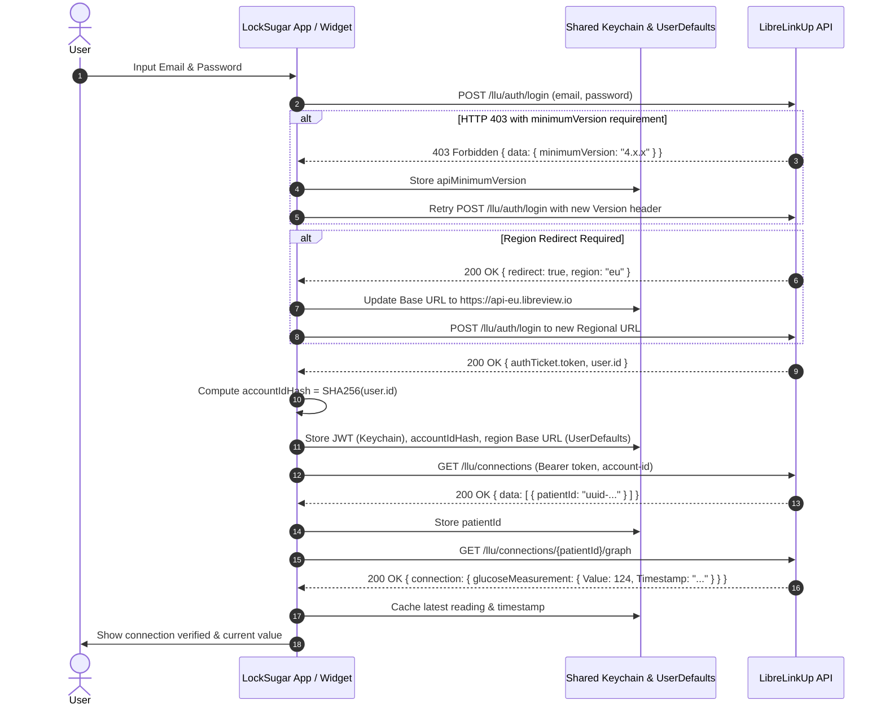

# Implementation Plan: LockSugar (`locksugar-ios`)

**LockSugar** is an ultra-minimalist native iOS application and Lock Screen WidgetKit accessory that displays the user's current blood glucose reading from LibreLinkUp directly on the iOS Lock Screen.

- **Main App**: Pure configuration utility — securely stores credentials, tests the LibreLinkUp connection, and shows setup instructions.
- **Lock Screen Widget**: Sits in the iOS Lock Screen accessory slots (`accessoryCircular`, `accessoryInline`, `accessoryRectangular`) displaying **nothing but the current glucose level** (no graphs, legends, or visual clutter).
- **Repository**: [`/Users/KREBSHA/git/privat/locksugar-ios`](file:///Users/KREBSHA/git/privat/locksugar-ios)

---

## 1. Technical Deep-Dive: LibreLinkUp Protocol & Engine

The core engine is a native Swift port of the reverse-engineered, battle-tested LibreLinkUp communication layer from [background.ts](file:///Users/KREBSHA/git/privat/cgm-monitor-chrome-extension/src/extension/background/background.ts).



### Protocol Specifications & Headers

Every request to LibreLinkUp sends Android app spoofing headers:

| Header | Value | Description |
| :--- | :--- | :--- |
| `product` | `llu.android` | Client identifier spoofing official LibreLinkUp Android app |
| `version` | Dynamic (fallback: `4.16.0`) | Client version. Automatically updated on 403 minimum version response |
| `accept-encoding` | `gzip` | Standard compression |
| `cache-control` | `no-cache` | Prevents stale intermediate responses |
| `connection` | `Keep-Alive` | Connection reuse |
| `content-type` | `application/json` | JSON payload format |
| `authorization` | `Bearer <jwtToken>` | Present on all authenticated endpoints |
| `account-id` | `<sha256(user.id)>` | Lowercase hex string of SHA-256 hash of `user.id` |

### Glucose Units & Typography Formatting

LibreLinkUp accounts return readings in either `mg/dL` or `mmol/L` depending on region and account profile:
- `glucoseMeasurement.Value`: Current reading pre-formatted by LibreLinkUp for the account's units.
- `glucoseMeasurement.GlucoseUnits`: `0` for `mg/dL`, `1` for `mmol/L`.
- `glucoseMeasurement.ValueInMgPerDl`: Normalized integer in mg/dL.

**Lock Screen Typography Rules**:
- **Integer values (typically mg/dL)**: Formatted as whole numbers (e.g., `124`).
- **Decimal values (typically mmol/L)**: Formatted with 1 decimal place (e.g., `6.9`).
- **Staleness Visual Cue**: If the last reading is older than 20 minutes (e.g., sensor lost signal or network offline), display the value in subtle dim opacity (0.5) to keep the display completely uncluttered while alerting the user that the value is not fresh.
- **Unconfigured / Warming Up**: Display `---`.

---

## 2. iOS Architecture, App Groups & Keychain Sharing

Because the iOS App and Widget Extension run in separate sandboxes, shared access is required:

```
┌────────────────────────────────────────────────────────┐
│                      LockSugar                         │
│                                                        │
│  ┌────────────────────────┐  ┌───────────────────────┐ │
│  │     LockSugar App      │  │   LockSugar Widget    │ │
│  │     (Main Target)      │  │  (Extension Target)   │ │
│  └───────────┬────────────┘  └───────────┬───────────┘ │
│              │                           │             │
│              ▼                           ▼             │
│  ┌──────────────────────────────────────────────────┐  │
│  │             Shared Framework / Core              │  │
│  │   LibreLinkUpClient • Models • Crypto • Storage   │  │
│  └───────────────────────┬──────────────────────────┘  │
└──────────────────────────┼─────────────────────────────┘
                           │
        ┌──────────────────┴──────────────────┐
        ▼                                     ▼
┌───────────────────────────────┐ ┌───────────────────────────────┐
│        Shared Keychain        │ │      Shared UserDefaults      │
│  kSecAttrAccessGroup:         │ │  UserDefaults(suiteName:      │
│  "$(AppIdentifierPrefix)      │ │   "group.com.hanskrebs.       │
│   group.com.hanskrebs.        │ │    locksugar")                │
│   locksugar"                  │ │                               │
│                               │ │  • accountIdHash              │
│  • email                      │ │  • patientId                  │
│  • password                   │ │  • apiBaseUrl                 │
│  • jwtToken                   │ │  • apiMinimumVersion          │
│                               │ │  • cachedGlucoseReading       │
│  (Enables silent re-auth in   │ │                               │
│   widget without app launch)  │ │                               │
└───────────────────────────────┘ └───────────────────────────────┘
```

---

## 3. WidgetKit Lifecycle & Background Budget Strategy

### The iOS Background Constraint
WidgetKit enforces a rolling 24-hour reload budget (~40 to 70 reloads per day). A naive 5-minute reload policy (288 reloads/day) will eventually be throttled by iOS when the device is locked and idle.

### LockSugar Refresh Strategy
1. **Intelligent Timeline Scheduling**:
   - The LibreLinkUp cloud syncs every 5 minutes.
   - When `TimelineProvider.getTimeline` runs, compute:
     `nextReloadDate = measurementTimestamp + 5 minutes + 15 seconds buffer`.
   - Fallback policy when measurement timestamp is unavailable: `.after(Date().addingTimeInterval(5 * 60))`.
2. **Foreground Fast-Path Reload**:
   - When the user opens the host app or when the app becomes active:
     `WidgetCenter.shared.reloadTimelines(ofKind: "LockSugarWidget")`.
3. **Background Task Keepalive (`BGAppRefreshTask`)**:
   - Register identifier `com.hanskrebs.locksugar.refresh` in `BGTaskScheduler`.
   - When iOS wakes the host app in the background, fetch the latest reading and call `WidgetCenter.shared.reloadTimelines(ofKind: "LockSugarWidget")` to refresh the cached reading and request a widget reload. Note that iOS decides when (and whether) to run background tasks, and widget reloads requested this way may still count against the WidgetKit budget, so treat this as best-effort rather than a guaranteed refresh path.
4. **ActivityKit / Live Activity Readiness (future, out of scope for Phases 1–4)**:
   - Keep `LibreLinkUpClient` decoupled in `Shared/Network/` so an iOS 16.1+ Lock Screen Live Activity can be added seamlessly if un-throttled real-time continuous streaming is desired.

---

## 4. Project Structure (`locksugar-ios`)

```
/Users/KREBSHA/git/privat/locksugar-ios/
├── LockSugar.xcodeproj
│
├── Shared/                                   # Shared code (both targets)
│   ├── Models/
│   │   ├── GlucoseReading.swift              # Reading, timestamp, unit formatting
│   │   └── LibreLinkUpResponses.swift        # Login, Connection, Graph Decodable structs
│   ├── Storage/
│   │   ├── KeychainHelper.swift              # Shared Keychain wrapper (kSecAttrAccessGroup)
│   │   └── SharedStorage.swift               # Shared UserDefaults wrapper
│   └── Network/
│       ├── CryptoUtils.swift                 # Pure Apple CryptoKit SHA-256
│       └── LibreLinkUpClient.swift           # Auth, versioning, redirect, graph fetching
│
├── LockSugar/                                # Main App Target
│   ├── LockSugarApp.swift                    # App lifecycle & BGTask registration
│   ├── ViewModels/
│   │   └── AppViewModel.swift                # State management, connection verification
│   ├── Views/
│   │   ├── ContentView.swift                 # Credentials form & status display
│   │   └── WidgetSetupInstructionsView.swift # Visual guide for adding widget to Lock Screen
│   └── Assets.xcassets
│
└── LockSugarWidget/                          # Widget Extension Target
    ├── LockSugarWidgetBundle.swift           # Widget Bundle entry
    ├── LockSugarWidget.swift                 # Widget configuration & TimelineProvider
    ├── Views/
    │   ├── LockSugarCircularView.swift       # accessoryCircular (Large bold number)
    │   ├── LockSugarInlineView.swift         # accessoryInline (Single-line number)
    │   └── LockSugarRectangularView.swift    # accessoryRectangular (Centered bold number)
    └── Assets.xcassets
```

---

## 5. Phased Implementation Roadmap

### Phase 1: Xcode Project & Entitlements Setup
- [ ] Generate `LockSugar.xcodeproj` linking `Shared/` files to both targets.
- [ ] Configure `App Groups` entitlement (`group.com.hanskrebs.locksugar`) on both targets.
- [ ] Configure `Keychain Sharing` entitlement (`$(AppIdentifierPrefix)group.com.hanskrebs.locksugar`) on both targets.
- [ ] Configure `Background Modes` (`fetch`) for `BGAppRefreshTask`.

### Phase 2: Shared Core & LibreLinkUp Engine
- [ ] Create `CryptoUtils.swift` using Apple `CryptoKit` for SHA-256 account ID calculation.
- [ ] Implement `LibreLinkUpResponses.swift` with decodable models for login, redirect, connections, and graph.
- [ ] Implement `KeychainHelper.swift` and `SharedStorage.swift` for App Group data access.
- [ ] Implement `LibreLinkUpClient.swift`:
  - `login(email, password)` with 403 `minimumVersion` detection and retry.
  - Regional redirect handling (`api-${region}.libreview.io`).
  - `getConnections()` and `getGraph()`.
  - Silent token renewal using Keychain credentials.

### Phase 3: Host Configuration App (`LockSugar`)
- [ ] Build `AppViewModel.swift` with connection testing, error feedback, and persistence.
- [ ] Build `ContentView.swift`:
  - Clean credentials input (email & password).
  - "Verify Connection" action button.
  - Success banner showing live glucose value and connection status.
- [ ] Build `WidgetSetupInstructionsView.swift` explaining how to customize the iOS Lock Screen.
- [ ] Register `BGAppRefreshTask` in `LockSugarApp.swift`.

### Phase 4: Lock Screen Widget Extension (`LockSugarWidget`)
- [ ] Implement `TimelineProvider`:
  - `placeholder(in:)`: Returns mock reading `124`.
  - `getSnapshot(in:completion:)`: Returns cached reading or mock.
  - `getTimeline(in:completion:)`: Asynchronously calls `LibreLinkUpClient.fetchCurrentReading()`, sets next reload date, and returns timeline entry.
- [ ] Build Widget Views:
  - `LockSugarCircularView` (`.accessoryCircular`): Centered bold rounded number.
  - `LockSugarInlineView` (`.accessoryInline`): Minimal text number.
  - `LockSugarRectangularView` (`.accessoryRectangular`): Centered number.
  - Apply staleness opacity modifier (0.5 opacity if older than 20 min).

---

## 6. Verification & Quality Gate

### Automated Tests
- **Crypto & Hash**: Test `CryptoUtils.sha256Hex("uuid-1234")` matches expected lowercase hex.
- **Payload Parsing**: Decode sample LibreLinkUp JSON payloads (from [graph-data.json](file:///Users/KREBSHA/git/privat/cgm-monitor-chrome-extension/graph-data.json)).
- **Unit Formatting**:
  - `124` mg/dL -> `"124"`
  - `6.9` mmol/L -> `"6.9"`
  - `5.0` mmol/L -> `"5.0"` (or `"5"`)
- **Version Negotiation**: Mock 403 response with `{ "data": { "minimumVersion": "4.17.0" } }` and verify version bump and automatic retry.

### Agent-Executable Verification (no human required)
An agent can run all of these from the CLI and the iOS Simulator:
1. **Build**: `xcodebuild build -project LockSugar.xcodeproj -scheme LockSugar -destination 'platform=iOS Simulator,name=iPhone 15'` succeeds for both the app and widget targets with zero errors.
2. **Unit tests**: `xcodebuild test -scheme LockSugar -destination 'platform=iOS Simulator,name=iPhone 15'` runs the Automated Tests above against a mocked `URLProtocol` (no network, no real credentials).
3. **Entitlements check**: `codesign -d --entitlements - <built .app / .appex>` (or inspecting the `.entitlements` files) shows the App Group and Keychain access group on both targets; `Info.plist` contains `BGTaskSchedulerPermittedIdentifiers` with `com.hanskrebs.locksugar.refresh` and the `fetch` background mode.
4. **Widget rendering**: Snapshot tests (e.g. `ImageRenderer` or swift-snapshot-testing) render the three accessory views for fresh, stale (0.5 opacity), unconfigured (`---`), mg/dL and mmol/L states, and assert that only the number is present.
5. **Simulator smoke test**: Install and launch the app on the Simulator with `xcrun simctl`, take a screenshot (`xcrun simctl io booted screenshot`) and confirm the credentials form renders.
6. **Timeline logic**: Unit-test `getTimeline` with injected fixed clock and mock client, asserting `nextReloadDate = timestamp + 5 min + 15 s` and the 5-minute fallback.
7. **Token renewal**: Unit-test the client with an expired/missing JWT in a fake Keychain store and assert silent re-login using stored credentials.

### Manual Verification (human only, needs a real device and account)
1. **Credentials Validation**: Log in via the host app, verify successful connection, and confirm credentials are saved in the Shared Keychain.
2. **Lock Screen Gallery**: Long press lock screen -> Customize -> Add Widget -> verify `LockSugar` appears and previews correctly.
3. **Glanceable Display**: Add `accessoryCircular` and `accessoryInline`. Confirm **only the reading number** is visible.
4. **Token Expiry Resilience**: Manually delete `jwtToken` from the Shared Keychain (keeping email/password); confirm widget silently re-authenticates on next reload using Keychain credentials.
